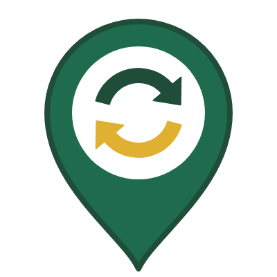

<p align="center"></p>

# TossMap MCP server

Find out where to drop off household hazardous waste in the US — leftover paint, batteries, e-waste, tires, motor oil and household chemicals — by ZIP code or city.

TossMap is a hosted, remote MCP server. There is nothing to install or run: point your MCP client at the endpoint below.

- **Endpoint:** `https://api.tossmap.com/mcp`
- **Transport:** Streamable HTTP (stateless, JSON responses)
- **Auth:** none
- **Data:** 213 official-source drop-off sites across 54 US metros, each with address, hours, fees, eligibility answers backed by evidence, a link to the operator's official page and a last-checked date
- **Website:** https://tossmap.com · **Agent docs:** https://api.tossmap.com/llms.txt · **MCP Registry name:** `com.tossmap/tossmap`

## Tools

| Tool | What it does | Arguments |
| --- | --- | --- |
| `search_facilities` | Find drop-off facilities near a ZIP code or in a covered city that accept a material | `material` (required: `paint`, `batteries`, `e_waste`, `tires`, `motor_oil`, `household_chemicals`), plus `zip` **or** `city` (optional `state`), optional `limit` (1–10) |
| `get_facility` | Get one facility's full record | `id` (from `search_facilities` results) |
| `coverage` | Check whether a ZIP or city is covered and find the nearest covered metro | `zip` **or** `city` (optional `state`) |

All tools are read-only.

## Free allowance and pricing

- `coverage` is always free, and so are searches that return no results.
- Each caller gets **3 free result-bearing calls per day** (`search_facilities` or `get_facility`, counted per caller per UTC day and shared with the REST API).
- After that, the tool returns a clear "payment required" result with the price, the paid REST URL and the full [x402](https://www.x402.org/) payment details. Paid calls go to the REST API at `https://api.tossmap.com` and are paid per call in USDC on Base:
  - search with results: $0.01
  - one facility record: $0.005
  - full dataset snapshot (`/v1/snapshot`): $5

## Client configuration

Most clients that support remote servers accept:

```json
{
  "mcpServers": {
    "tossmap": {
      "url": "https://api.tossmap.com/mcp"
    }
  }
}
```

Claude Code:

```sh
claude mcp add --transport http tossmap https://api.tossmap.com/mcp
```

VS Code (`.vscode/mcp.json`):

```json
{
  "servers": {
    "tossmap": { "type": "http", "url": "https://api.tossmap.com/mcp" }
  }
}
```

Try it with the MCP Inspector:

```sh
npx @modelcontextprotocol/inspector --cli https://api.tossmap.com/mcp --transport http --method tools/list
```

## Discovery files

- MCP Registry `server.json`: [server.json](server.json) (also at https://api.tossmap.com/server.json)
- Server card: https://api.tossmap.com/.well-known/mcp/server-card.json
- x402 discovery: https://api.tossmap.com/.well-known/x402
- OpenAPI: https://api.tossmap.com/openapi.json

## Disclaimer

Confirm with the facility operator before driving. A listing does not guarantee that a site will accept your material.

This repository holds only the server's public metadata and documentation. The server itself is hosted by TossMap.
